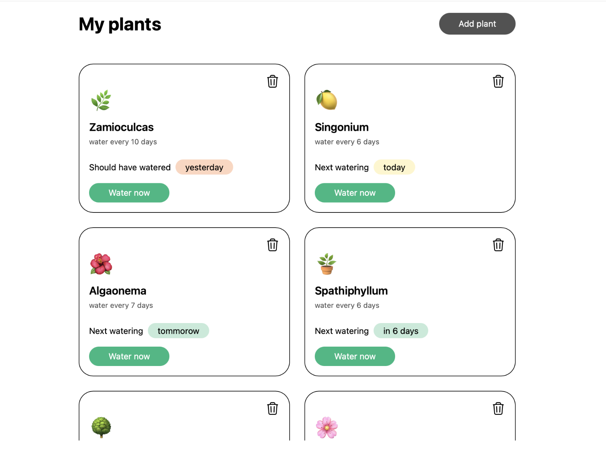
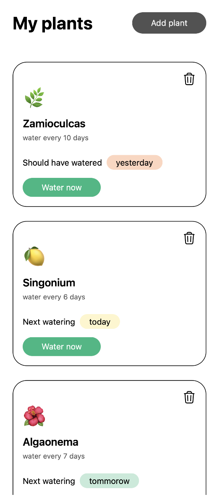
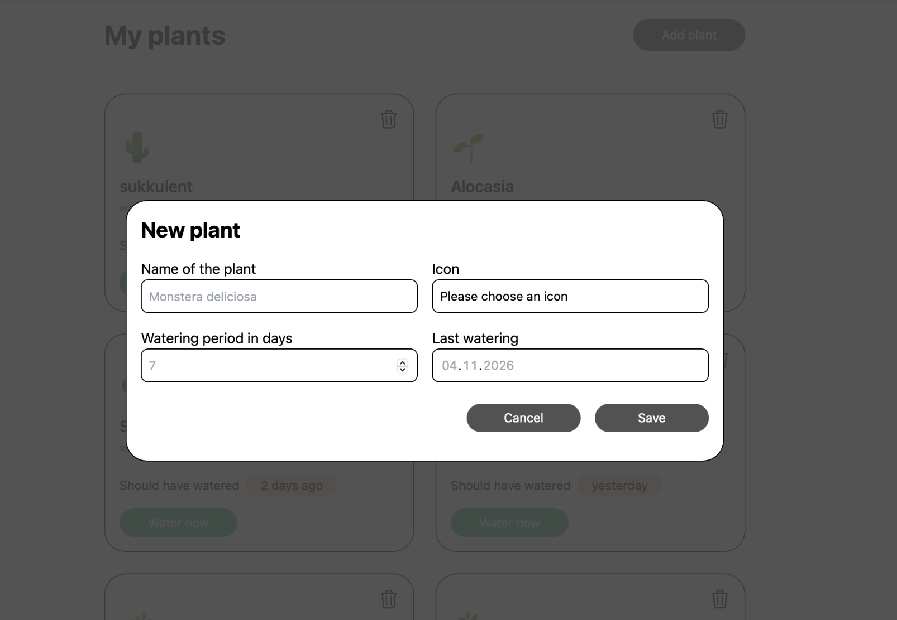

# Plant Watering Tracker

A simple app that keeps track of when to water your houseplants. Built with vanilla JavaScript, without frameworks. This was my first project.

**[Live demo](link)**

## Screenshots

| Desktop | Mobile |
|:---:|:---:|
|  |  |

## Features

- Add a plant card: enter a name, choose an icon, the watering interval and the date of the last watering
- See when the next watering is due
- Press "Water now" to update the last watering date and recalculate the next one
- Data is saved in the browser, so plants are still there after a page reload
- Responsive layout for mobile screens

## Tech stack

- **HTML5**, **CSS3**
- **JavaScript (ES6+)**: DOM manipulation, event handling, working with dates
- **Tailwind CSS**: styling
- **localStorage**: data persistence